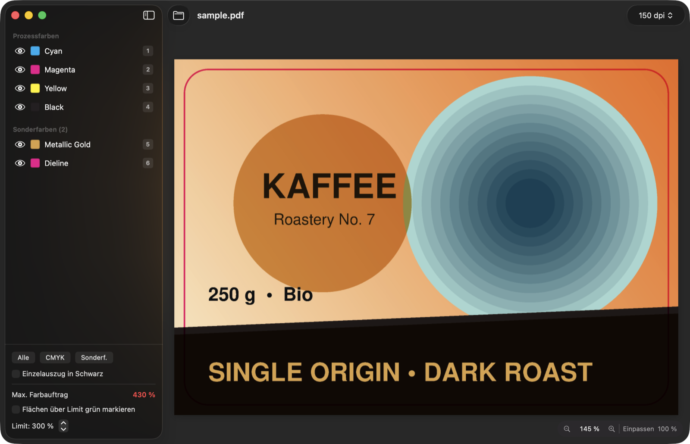
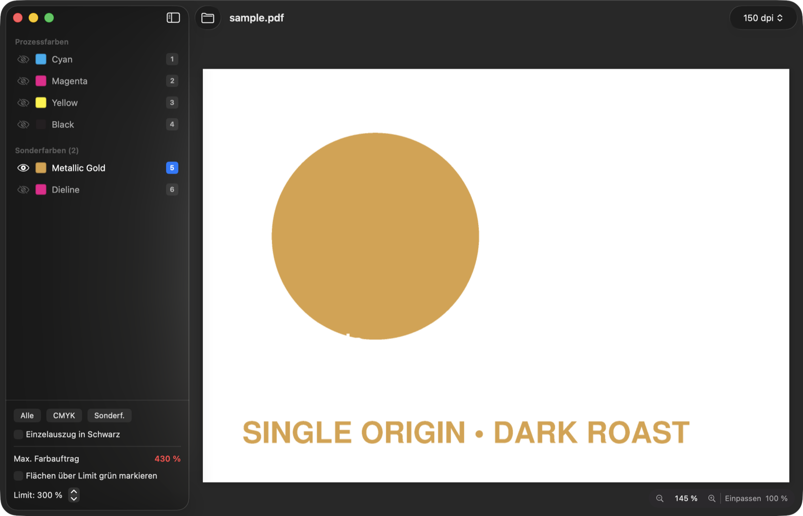
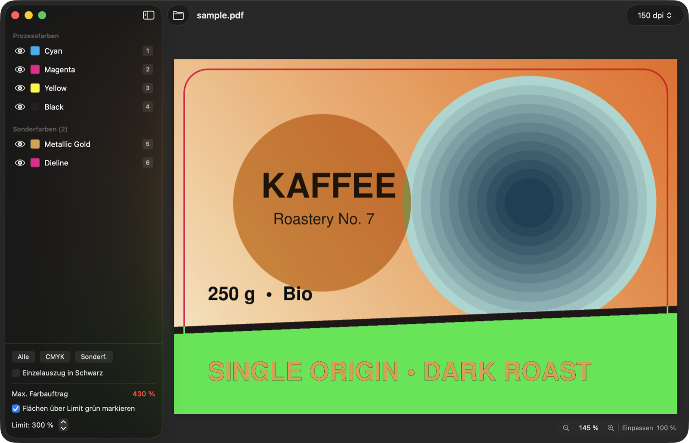

# SepCheck

**Druckdaten-Kontrolle für macOS:** PDF öffnen, CMYK-Auszüge und Sonderfarben einzeln ansehen
und den Gesamtfarbauftrag messen. Überdrucken wird dabei berücksichtigt, so wie ein RIP separiert.

🇬🇧 [English version](README.md)



## Funktionen

- Separation mit dem `tiffsep`-Device von Ghostscript, **Überdrucken** wird berücksichtigt
- **Prozess- und Sonderfarben** als einzelne Auszüge. Die Vorschaufarbe einer Sonderfarbe stammt
  aus deren CMYK-Alternativwert im PDF
- **Tonwerte unter dem Mauszeiger** für jeden Kanal plus Gesamtfarbauftrag
- **Farbauftrag-Warnung:** Flächen über einem einstellbaren Limit (Standard 300 %) werden grün markiert
- Einzelauszug in Schwarz, Kanäle solo schalten oder ausblenden, Zoom bis Druckgröße
- Mehrseitige Dokumente, Drag & Drop, „Öffnen mit“ im Finder
- Oberfläche auf Deutsch und Englisch (richtet sich nach der macOS-Sprache)

| Eine Sonderfarbe als Einzelauszug | Flächen über dem Farbauftrags-Limit grün markiert |
|---|---|
|  |  |

## Voraussetzungen

- macOS 14 Sonoma oder neuer
- [Ghostscript](https://ghostscript.com): `brew install ghostscript`
  (wird in `/opt/homebrew/bin`, `/usr/local/bin`, `/opt/local/bin`, `/usr/bin` gesucht)
- Xcode Command Line Tools zum Bauen (`xcode-select --install`). Das volle Xcode brauchst du nicht.

## Bauen & installieren

```bash
git clone https://github.com/patkon/SepCheck.git
cd SepCheck
./build-app.sh
```

Danach `SepCheck.app` nach /Programme ziehen. Die App ist nur ad hoc signiert und läuft auf dem
Mac, auf dem sie gebaut wurde.

## Bedienung

| Aktion | |
|---|---|
| PDF öffnen | ⌘O, Drag & Drop ins Fenster oder aufs Dock-Icon, „Öffnen mit“ im Finder |
| Auszug ein-/ausblenden | Auge in der Seitenleiste |
| Nur einen Auszug zeigen | Taste **1–9** (bzw. Ziffern-Button / Doppelklick), nochmal = alle |
| Alle Auszüge | Taste **0** |
| Einzelauszug in Schwarz | Taste **B** |
| Farbauftrag-Warnung (grün) | Taste **T**, Limit in der Seitenleiste (Standard 300 %) |
| Zoom | ⌘+ / ⌘– / Pinch, ⌘0 einpassen, ⌘1 = 100 % Druckgröße |
| Seiten | ⌘← / ⌘→ |

## Grenzen

- Die Bildschirmfarben sind eine Näherung ohne Farbmanagement. SepCheck ist zur Kontrolle von
  Auszügen, Überdrucken und Farbauftrag gedacht, nicht als farbverbindlicher Softproof.
- Tonwertangaben gelten bei der gewählten Render-Auflösung. Bei 72 dpi werden Raster und feine
  Linien geglättet, für Details 300 dpi wählen.

## Projektstruktur

```
Package.swift            Swift-Package (macOS 14+)
Sources/SepCheck/        App-Quellcode (SwiftUI)
Resources/Info.plist     Bundle-Infos, PDF-Dokumenttyp
Resources/*.lproj        Übersetzungen (Schlüssel = englische Texte im Code)
Resources/icon-*.png     App-Icon (große Größen / vereinfacht 16–64 px)
build-app.sh             Baut SepCheck.app
docs/                    README-Screenshots, Beispiel-PDF (sample.ps = Quelle)
```

## Lizenz

[MIT](LICENSE). SepCheck ruft Ghostscript als separates Programm auf und liefert es nicht mit.
Ghostscript selbst steht unter der AGPL (Artifex Software).
