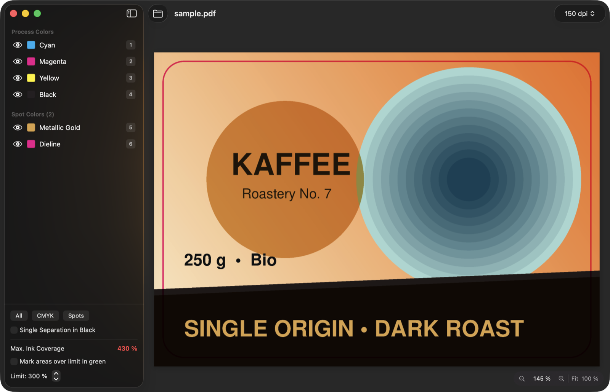
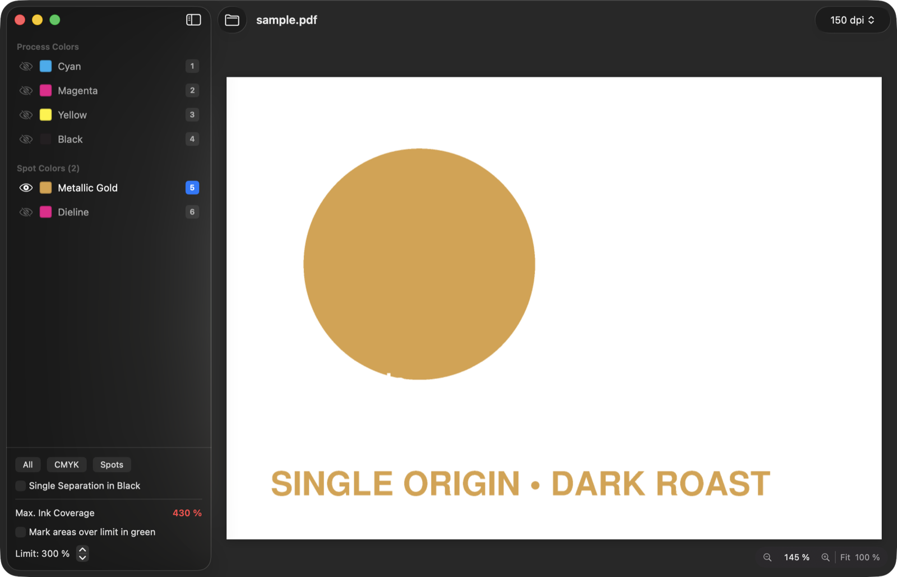
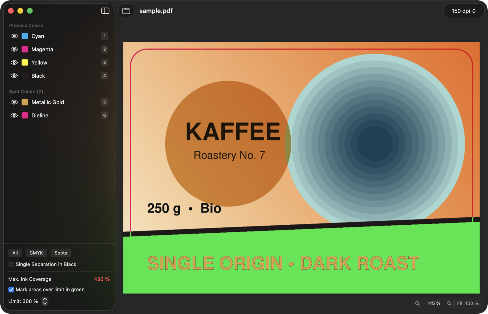

# SepCheck

**Prepress separation preview for macOS.** Open a PDF, inspect each CMYK and spot color
separation on its own, and measure total ink coverage — overprint included, the way a RIP
would separate it.

🇩🇪 [Deutsche Version](README.de.md)



## Features

- Separates PDFs with Ghostscript's `tiffsep` device, so **overprint** is honored
- Shows **process and spot colors** as individual separations; spot color previews use the
  CMYK alternate values from the PDF
- **Tone values under the pointer** for every channel, plus total ink coverage
- **Ink coverage warning:** marks areas above a configurable limit (default 300 %) in green
- Single separation in black, solo/hide any channel, zoom up to actual print size
- Multi-page documents, drag & drop, "Open With" from the Finder
- UI in English and German (follows your macOS language)

| A single spot color separation | Areas above the ink limit marked in green |
|---|---|
|  |  |

## Requirements

- macOS 14 Sonoma or later
- [Ghostscript](https://ghostscript.com) — `brew install ghostscript`
  (searched in `/opt/homebrew/bin`, `/usr/local/bin`, `/opt/local/bin`, `/usr/bin`)
- Xcode Command Line Tools to build (`xcode-select --install`). You don't need the full Xcode.

## Build & install

```bash
git clone https://github.com/patkon/SepCheck.git
cd SepCheck
./build-app.sh
```

Then drag `SepCheck.app` to `/Applications`. The app is signed ad hoc only, so it runs on the
Mac it was built on.

## Usage

| Action | |
|---|---|
| Open PDF | ⌘O, drag & drop onto the window or Dock icon, "Open With" in the Finder |
| Show/hide a separation | Eye icon in the sidebar |
| Show only one separation | Key **1–9** (or the number button / double-click). Press again to show all |
| All separations | Key **0** |
| Single separation in black | Key **B** |
| Ink coverage warning (green) | Key **T**, limit set in the sidebar (default 300 %) |
| Zoom | ⌘+ / ⌘– / pinch, ⌘0 fit, ⌘1 = 100 % print size |
| Pages | ⌘← / ⌘→ |

## Limitations

- Screen colors are an approximation without color management. SepCheck is for checking
  separations, overprint and ink coverage, not a color-accurate soft proof.
- Tone values apply at the selected render resolution. At 72 dpi, screens and fine lines are
  smoothed, so use 300 dpi for detail.

## Project structure

```
Package.swift            Swift package (macOS 14+)
Sources/SepCheck/        App source (SwiftUI)
Resources/Info.plist     Bundle info, PDF document type
Resources/*.lproj        Localizations (keys = English source strings)
Resources/icon-*.png     App icon (large sizes / simplified 16–64 px)
build-app.sh             Builds SepCheck.app
docs/                    README screenshots, sample PDF (sample.ps = source)
```

### Adding a language

Copy `Resources/de.lproj` to `<lang>.lproj`, translate the values, and add the language code to
`CFBundleLocalizations` in `Resources/Info.plist`.

## License

[MIT](LICENSE). SepCheck calls Ghostscript as a separate program and does not bundle it.
Ghostscript itself is licensed under the AGPL by Artifex Software.
